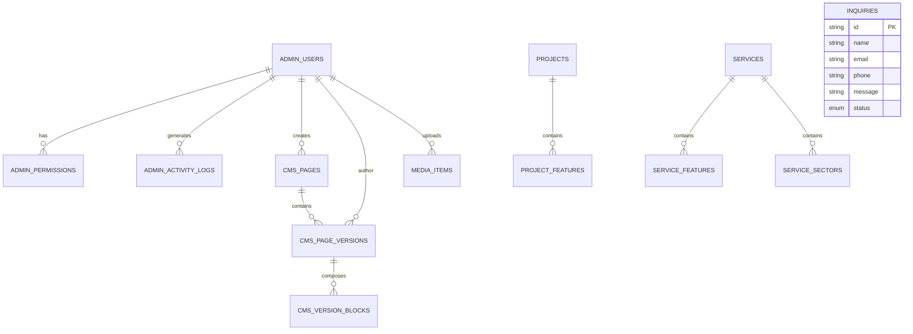

# HEDABKH React-PHP — Phase 2: Relational Database Schema Specification

**Target Database Management System:** MariaDB 10.4+ / MySQL 8.0+  
**Collation:** `utf8mb4_unicode_ci` (Full Unicode & Arabic RTL Diacritics Support)  
**Storage Engine:** `InnoDB` (ACID Transactions, Foreign Key Constraints, Row-Level Locking)  
**JSON Support:** Native `JSON` Column Types with Indexable Generated Virtual Columns  

---

## 1. Entity-Relationship Architecture Diagram



---

## 2. DDL Schema Specification

### 2.1 Identity, Users & RBAC Module

#### `admin_users`
Stores authenticated administrative accounts with secure bcrypt/Argon2 hashes.
```sql
CREATE TABLE `admin_users` (
  `id` VARCHAR(64) NOT NULL,
  `email` VARCHAR(191) NOT NULL,
  `password_hash` VARCHAR(255) NOT NULL,
  `name` VARCHAR(191) NOT NULL,
  `role` ENUM('super_admin', 'project_manager', 'quality_officer', 'inquiries_manager', 'content_editor') NOT NULL DEFAULT 'project_manager',
  `avatar` VARCHAR(500) DEFAULT NULL,
  `phone` VARCHAR(64) DEFAULT NULL,
  `status` ENUM('active', 'inactive', 'suspended') NOT NULL DEFAULT 'active',
  `last_login_at` DATETIME DEFAULT NULL,
  `created_at` DATETIME NOT NULL DEFAULT CURRENT_TIMESTAMP,
  `updated_at` DATETIME NOT NULL DEFAULT CURRENT_TIMESTAMP ON UPDATE CURRENT_TIMESTAMP,
  PRIMARY KEY (`id`),
  UNIQUE KEY `uk_admin_users_email` (`email`),
  KEY `idx_admin_users_role_status` (`role`, `status`)
) ENGINE=InnoDB DEFAULT CHARSET=utf8mb4 COLLATE=utf8mb4_unicode_ci;
```

#### `admin_permissions`
Granular permission tokens assigned per user.
```sql
CREATE TABLE `admin_permissions` (
  `id` BIGINT UNSIGNED NOT NULL AUTO_INCREMENT,
  `user_id` VARCHAR(64) NOT NULL,
  `permission_key` VARCHAR(64) NOT NULL,
  PRIMARY KEY (`id`),
  UNIQUE KEY `uk_user_permission` (`user_id`, `permission_key`),
  CONSTRAINT `fk_admin_permissions_user` FOREIGN KEY (`user_id`) REFERENCES `admin_users` (`id`) ON DELETE CASCADE
) ENGINE=InnoDB DEFAULT CHARSET=utf8mb4 COLLATE=utf8mb4_unicode_ci;
```

#### `admin_activity_logs`
Audit log recording every administrative mutation.
```sql
CREATE TABLE `admin_activity_logs` (
  `id` VARCHAR(64) NOT NULL,
  `user_id` VARCHAR(64) DEFAULT NULL,
  `admin_name` VARCHAR(191) NOT NULL,
  `action` ENUM('create', 'update', 'delete', 'status_change', 'publish', 'rollback') NOT NULL,
  `entity_type` VARCHAR(64) NOT NULL,
  `entity_id` VARCHAR(64) NOT NULL,
  `entity_title` VARCHAR(255) NOT NULL,
  `ip_address` VARCHAR(45) DEFAULT NULL,
  `user_agent` VARCHAR(255) DEFAULT NULL,
  `created_at` DATETIME NOT NULL DEFAULT CURRENT_TIMESTAMP,
  PRIMARY KEY (`id`),
  KEY `idx_logs_created_at` (`created_at`),
  KEY `idx_logs_entity` (`entity_type`, `entity_id`),
  CONSTRAINT `fk_logs_user` FOREIGN KEY (`user_id`) REFERENCES `admin_users` (`id`) ON DELETE SET NULL
) ENGINE=InnoDB DEFAULT CHARSET=utf8mb4 COLLATE=utf8mb4_unicode_ci;
```

---

### 2.2 Projects Module

#### `projects`
```sql
CREATE TABLE `projects` (
  `id` VARCHAR(64) NOT NULL,
  `slug` VARCHAR(191) NOT NULL,
  `title_ar` VARCHAR(255) NOT NULL,
  `title_en` VARCHAR(255) NOT NULL,
  `description_ar` TEXT NOT NULL,
  `description_en` TEXT NOT NULL,
  `category_ar` VARCHAR(191) NOT NULL,
  `category_en` VARCHAR(191) NOT NULL,
  `image_url` VARCHAR(500) NOT NULL,
  `site_prep_image` VARCHAR(500) DEFAULT NULL,
  `execution_phase_image` VARCHAR(500) DEFAULT NULL,
  `final_handover_image` VARCHAR(500) DEFAULT NULL,
  `completion_date` DATE NOT NULL,
  `location_ar` VARCHAR(191) NOT NULL,
  `location_en` VARCHAR(191) NOT NULL,
  `client_ar` VARCHAR(191) NOT NULL,
  `client_en` VARCHAR(191) NOT NULL,
  `progress_percent` TINYINT UNSIGNED NOT NULL DEFAULT 100,
  `is_featured` TINYINT(1) NOT NULL DEFAULT 0,
  `is_active` TINYINT(1) NOT NULL DEFAULT 1,
  `sort_order` INT NOT NULL DEFAULT 0,
  `created_at` DATETIME NOT NULL DEFAULT CURRENT_TIMESTAMP,
  `updated_at` DATETIME NOT NULL DEFAULT CURRENT_TIMESTAMP ON UPDATE CURRENT_TIMESTAMP,
  PRIMARY KEY (`id`),
  UNIQUE KEY `uk_projects_slug` (`slug`),
  KEY `idx_projects_category` (`category_ar`),
  KEY `idx_projects_featured_active` (`is_featured`, `is_active`)
) ENGINE=InnoDB DEFAULT CHARSET=utf8mb4 COLLATE=utf8mb4_unicode_ci;
```

#### `project_features`
```sql
CREATE TABLE `project_features` (
  `id` BIGINT UNSIGNED NOT NULL AUTO_INCREMENT,
  `project_id` VARCHAR(64) NOT NULL,
  `feature_ar` VARCHAR(500) NOT NULL,
  `feature_en` VARCHAR(500) NOT NULL,
  `sort_order` INT NOT NULL DEFAULT 0,
  PRIMARY KEY (`id`),
  KEY `idx_project_features_proj` (`project_id`),
  CONSTRAINT `fk_project_features_project` FOREIGN KEY (`project_id`) REFERENCES `projects` (`id`) ON DELETE CASCADE
) ENGINE=InnoDB DEFAULT CHARSET=utf8mb4 COLLATE=utf8mb4_unicode_ci;
```

---

### 2.3 Services Module

#### `services`
```sql
CREATE TABLE `services` (
  `id` VARCHAR(64) NOT NULL,
  `slug` VARCHAR(191) NOT NULL,
  `title_ar` VARCHAR(255) NOT NULL,
  `title_en` VARCHAR(255) NOT NULL,
  `description_ar` TEXT NOT NULL,
  `description_en` TEXT NOT NULL,
  `icon_key` VARCHAR(64) NOT NULL DEFAULT 'building-icon',
  `is_active` TINYINT(1) NOT NULL DEFAULT 1,
  `sort_order` INT NOT NULL DEFAULT 0,
  `created_at` DATETIME NOT NULL DEFAULT CURRENT_TIMESTAMP,
  `updated_at` DATETIME NOT NULL DEFAULT CURRENT_TIMESTAMP ON UPDATE CURRENT_TIMESTAMP,
  PRIMARY KEY (`id`),
  UNIQUE KEY `uk_services_slug` (`slug`),
  KEY `idx_services_sort` (`sort_order`, `is_active`)
) ENGINE=InnoDB DEFAULT CHARSET=utf8mb4 COLLATE=utf8mb4_unicode_ci;
```

#### `service_features` & `service_sectors`
```sql
CREATE TABLE `service_features` (
  `id` BIGINT UNSIGNED NOT NULL AUTO_INCREMENT,
  `service_id` VARCHAR(64) NOT NULL,
  `feature_ar` VARCHAR(500) NOT NULL,
  `feature_en` VARCHAR(500) NOT NULL,
  `sort_order` INT NOT NULL DEFAULT 0,
  PRIMARY KEY (`id`),
  CONSTRAINT `fk_service_features_service` FOREIGN KEY (`service_id`) REFERENCES `services` (`id`) ON DELETE CASCADE
) ENGINE=InnoDB DEFAULT CHARSET=utf8mb4 COLLATE=utf8mb4_unicode_ci;

CREATE TABLE `service_sectors` (
  `id` BIGINT UNSIGNED NOT NULL AUTO_INCREMENT,
  `service_id` VARCHAR(64) NOT NULL,
  `sector_ar` VARCHAR(255) NOT NULL,
  `sector_en` VARCHAR(255) NOT NULL,
  `sort_order` INT NOT NULL DEFAULT 0,
  PRIMARY KEY (`id`),
  CONSTRAINT `fk_service_sectors_service` FOREIGN KEY (`service_id`) REFERENCES `services` (`id`) ON DELETE CASCADE
) ENGINE=InnoDB DEFAULT CHARSET=utf8mb4 COLLATE=utf8mb4_unicode_ci;
```

---

### 2.4 Machinery Fleet Module

#### `equipment_fleet`
```sql
CREATE TABLE `equipment_fleet` (
  `id` VARCHAR(64) NOT NULL,
  `name_ar` VARCHAR(255) NOT NULL,
  `name_en` VARCHAR(255) NOT NULL,
  `category_ar` VARCHAR(191) NOT NULL,
  `category_en` VARCHAR(191) NOT NULL,
  `model` VARCHAR(100) NOT NULL,
  `brand` VARCHAR(100) NOT NULL,
  `unit_count` SMALLINT UNSIGNED NOT NULL DEFAULT 1,
  `image_url` VARCHAR(500) NOT NULL,
  `is_active` TINYINT(1) NOT NULL DEFAULT 1,
  `sort_order` INT NOT NULL DEFAULT 0,
  `created_at` DATETIME NOT NULL DEFAULT CURRENT_TIMESTAMP,
  `updated_at` DATETIME NOT NULL DEFAULT CURRENT_TIMESTAMP ON UPDATE CURRENT_TIMESTAMP,
  PRIMARY KEY (`id`),
  KEY `idx_equipment_category` (`category_ar`)
) ENGINE=InnoDB DEFAULT CHARSET=utf8mb4 COLLATE=utf8mb4_unicode_ci;
```

---

### 2.5 Certificates & Accreditations Module

#### `certificates`
```sql
CREATE TABLE `certificates` (
  `id` VARCHAR(64) NOT NULL,
  `title_ar` VARCHAR(255) NOT NULL,
  `title_en` VARCHAR(255) NOT NULL,
  `issuer_ar` VARCHAR(255) NOT NULL,
  `issuer_en` VARCHAR(255) NOT NULL,
  `id_number` VARCHAR(100) NOT NULL,
  `issue_date` DATE NOT NULL,
  `expiry_date` DATE NOT NULL,
  `type` ENUM('government', 'iso') NOT NULL DEFAULT 'iso',
  `category` ENUM('official', 'classification', 'iso', 'identity') NOT NULL DEFAULT 'iso',
  `credit_rating` VARCHAR(100) DEFAULT NULL,
  `file_path` VARCHAR(500) DEFAULT NULL,
  `is_active` TINYINT(1) NOT NULL DEFAULT 1,
  `sort_order` INT NOT NULL DEFAULT 0,
  `created_at` DATETIME NOT NULL DEFAULT CURRENT_TIMESTAMP,
  `updated_at` DATETIME NOT NULL DEFAULT CURRENT_TIMESTAMP ON UPDATE CURRENT_TIMESTAMP,
  PRIMARY KEY (`id`),
  KEY `idx_certificates_type_cat` (`type`, `category`)
) ENGINE=InnoDB DEFAULT CHARSET=utf8mb4 COLLATE=utf8mb4_unicode_ci;
```

---

### 2.6 Leadership & Team Module

#### `team_members`
```sql
CREATE TABLE `team_members` (
  `id` VARCHAR(64) NOT NULL,
  `name_ar` VARCHAR(191) NOT NULL,
  `name_en` VARCHAR(191) NOT NULL,
  `role_ar` VARCHAR(191) NOT NULL,
  `role_en` VARCHAR(191) NOT NULL,
  `bio_ar` TEXT NOT NULL,
  `bio_en` TEXT NOT NULL,
  `image_url` VARCHAR(500) NOT NULL,
  `sector` ENUM('PROJECTS', 'OPERATIONS', 'QUALITY') NOT NULL DEFAULT 'PROJECTS',
  `badge_ar` VARCHAR(100) NOT NULL,
  `badge_en` VARCHAR(100) NOT NULL,
  `experience_ar` VARCHAR(100) NOT NULL,
  `experience_en` VARCHAR(100) NOT NULL,
  `email` VARCHAR(191) DEFAULT NULL,
  `phone` VARCHAR(64) DEFAULT NULL,
  `is_active` TINYINT(1) NOT NULL DEFAULT 1,
  `sort_order` INT NOT NULL DEFAULT 0,
  `created_at` DATETIME NOT NULL DEFAULT CURRENT_TIMESTAMP,
  `updated_at` DATETIME NOT NULL DEFAULT CURRENT_TIMESTAMP ON UPDATE CURRENT_TIMESTAMP,
  PRIMARY KEY (`id`),
  KEY `idx_team_sector` (`sector`)
) ENGINE=InnoDB DEFAULT CHARSET=utf8mb4 COLLATE=utf8mb4_unicode_ci;
```

---

### 2.7 Partners & Clients Module

#### `partners`
```sql
CREATE TABLE `partners` (
  `id` VARCHAR(64) NOT NULL,
  `name_ar` VARCHAR(255) NOT NULL,
  `name_en` VARCHAR(255) NOT NULL,
  `logo_url` VARCHAR(500) NOT NULL,
  `category` ENUM('government', 'ministry', 'amanah', 'authority', 'private') NOT NULL DEFAULT 'government',
  `contract_role_ar` VARCHAR(191) NOT NULL,
  `contract_role_en` VARCHAR(191) NOT NULL,
  `projects_count` SMALLINT UNSIGNED NOT NULL DEFAULT 0,
  `is_active` TINYINT(1) NOT NULL DEFAULT 1,
  `sort_order` INT NOT NULL DEFAULT 0,
  `created_at` DATETIME NOT NULL DEFAULT CURRENT_TIMESTAMP,
  `updated_at` DATETIME NOT NULL DEFAULT CURRENT_TIMESTAMP ON UPDATE CURRENT_TIMESTAMP,
  PRIMARY KEY (`id`)
) ENGINE=InnoDB DEFAULT CHARSET=utf8mb4 COLLATE=utf8mb4_unicode_ci;
```

---

### 2.8 News & Technical Articles Module

#### `articles`
```sql
CREATE TABLE `articles` (
  `id` VARCHAR(64) NOT NULL,
  `slug` VARCHAR(191) NOT NULL,
  `title_ar` VARCHAR(255) NOT NULL,
  `title_en` VARCHAR(255) NOT NULL,
  `category_ar` VARCHAR(191) NOT NULL,
  `category_en` VARCHAR(191) NOT NULL,
  `read_time_ar` VARCHAR(50) NOT NULL,
  `read_time_en` VARCHAR(50) NOT NULL,
  `published_date` DATE NOT NULL,
  `cover_image` VARCHAR(500) NOT NULL,
  `image_alt_ar` VARCHAR(255) NOT NULL,
  `image_alt_en` VARCHAR(255) NOT NULL,
  `summary_ar` TEXT NOT NULL,
  `summary_en` TEXT NOT NULL,
  `seo_title_ar` VARCHAR(255) NOT NULL,
  `seo_title_en` VARCHAR(255) NOT NULL,
  `meta_description_ar` TEXT NOT NULL,
  `meta_description_en` TEXT NOT NULL,
  `content_ar` MEDIUMTEXT NOT NULL,
  `content_en` MEDIUMTEXT NOT NULL,
  `status` ENUM('draft', 'published', 'archived') NOT NULL DEFAULT 'published',
  `created_by` VARCHAR(64) DEFAULT NULL,
  `created_at` DATETIME NOT NULL DEFAULT CURRENT_TIMESTAMP,
  `updated_at` DATETIME NOT NULL DEFAULT CURRENT_TIMESTAMP ON UPDATE CURRENT_TIMESTAMP,
  PRIMARY KEY (`id`),
  UNIQUE KEY `uk_articles_slug` (`slug`),
  KEY `idx_articles_status_date` (`status`, `published_date`),
  CONSTRAINT `fk_articles_user` FOREIGN KEY (`created_by`) REFERENCES `admin_users` (`id`) ON DELETE SET NULL
) ENGINE=InnoDB DEFAULT CHARSET=utf8mb4 COLLATE=utf8mb4_unicode_ci;
```

---

### 2.9 Statistics & Leads Module

#### `statistics`
```sql
CREATE TABLE `statistics` (
  `id` VARCHAR(64) NOT NULL,
  `key_name` VARCHAR(64) NOT NULL,
  `value_num` INT NOT NULL,
  `prefix_ar` VARCHAR(20) DEFAULT NULL,
  `prefix_en` VARCHAR(20) DEFAULT NULL,
  `suffix_ar` VARCHAR(20) DEFAULT NULL,
  `suffix_en` VARCHAR(20) DEFAULT NULL,
  `label_ar` VARCHAR(191) NOT NULL,
  `label_en` VARCHAR(191) NOT NULL,
  `description_ar` TEXT DEFAULT NULL,
  `description_en` TEXT DEFAULT NULL,
  `icon_key` VARCHAR(64) NOT NULL DEFAULT 'trending-up',
  `sort_order` INT NOT NULL DEFAULT 0,
  `updated_at` DATETIME NOT NULL DEFAULT CURRENT_TIMESTAMP ON UPDATE CURRENT_TIMESTAMP,
  PRIMARY KEY (`id`),
  UNIQUE KEY `uk_statistics_key` (`key_name`)
) ENGINE=InnoDB DEFAULT CHARSET=utf8mb4 COLLATE=utf8mb4_unicode_ci;
```

#### `inquiries`
```sql
CREATE TABLE `inquiries` (
  `id` VARCHAR(64) NOT NULL,
  `name` VARCHAR(191) NOT NULL,
  `email` VARCHAR(191) NOT NULL,
  `phone` VARCHAR(64) NOT NULL,
  `message` TEXT NOT NULL,
  `status` ENUM('new', 'in-progress', 'resolved') NOT NULL DEFAULT 'new',
  `notes` TEXT DEFAULT NULL,
  `ip_address` VARCHAR(45) DEFAULT NULL,
  `created_at` DATETIME NOT NULL DEFAULT CURRENT_TIMESTAMP,
  `updated_at` DATETIME NOT NULL DEFAULT CURRENT_TIMESTAMP ON UPDATE CURRENT_TIMESTAMP,
  PRIMARY KEY (`id`),
  KEY `idx_inquiries_status_created` (`status`, `created_at`)
) ENGINE=InnoDB DEFAULT CHARSET=utf8mb4 COLLATE=utf8mb4_unicode_ci;
```

---

### 2.10 Media Catalog Module

#### `media_items`
```sql
CREATE TABLE `media_items` (
  `id` VARCHAR(64) NOT NULL,
  `original_name` VARCHAR(255) NOT NULL,
  `stored_filename` VARCHAR(255) NOT NULL,
  `file_path` VARCHAR(500) NOT NULL,
  `file_url` VARCHAR(500) NOT NULL,
  `mime_type` VARCHAR(100) NOT NULL,
  `file_size_bytes` BIGINT UNSIGNED NOT NULL,
  `width_px` INT UNSIGNED DEFAULT NULL,
  `height_px` INT UNSIGNED DEFAULT NULL,
  `media_type` ENUM('image', 'document', 'badge', 'pdf') NOT NULL DEFAULT 'image',
  `category` VARCHAR(100) NOT NULL DEFAULT 'general',
  `alt_ar` VARCHAR(255) DEFAULT NULL,
  `alt_en` VARCHAR(255) DEFAULT NULL,
  `uploaded_by` VARCHAR(64) DEFAULT NULL,
  `created_at` DATETIME NOT NULL DEFAULT CURRENT_TIMESTAMP,
  PRIMARY KEY (`id`),
  KEY `idx_media_category_type` (`category`, `media_type`),
  CONSTRAINT `fk_media_user` FOREIGN KEY (`uploaded_by`) REFERENCES `admin_users` (`id`) ON DELETE SET NULL
) ENGINE=InnoDB DEFAULT CHARSET=utf8mb4 COLLATE=utf8mb4_unicode_ci;
```

---

### 2.11 Visual CMS & Block Engine Module (Hybrid Relational + JSON)

#### `cms_pages`
```sql
CREATE TABLE `cms_pages` (
  `id` VARCHAR(64) NOT NULL,
  `slug` VARCHAR(191) NOT NULL,
  `title_ar` VARCHAR(255) NOT NULL,
  `title_en` VARCHAR(255) NOT NULL,
  `template` VARCHAR(64) NOT NULL DEFAULT 'custom',
  `status` ENUM('draft', 'review', 'published') NOT NULL DEFAULT 'published',
  `published_version_id` VARCHAR(64) DEFAULT NULL,
  `draft_version_id` VARCHAR(64) DEFAULT NULL,
  `scheduled_publish_at` DATETIME DEFAULT NULL,
  `review_requested_by` VARCHAR(64) DEFAULT NULL,
  `review_requested_at` DATETIME DEFAULT NULL,
  `created_by` VARCHAR(64) DEFAULT NULL,
  `created_at` DATETIME NOT NULL DEFAULT CURRENT_TIMESTAMP,
  `updated_at` DATETIME NOT NULL DEFAULT CURRENT_TIMESTAMP ON UPDATE CURRENT_TIMESTAMP,
  PRIMARY KEY (`id`),
  UNIQUE KEY `uk_cms_pages_slug` (`slug`)
) ENGINE=InnoDB DEFAULT CHARSET=utf8mb4 COLLATE=utf8mb4_unicode_ci;
```

#### `cms_page_versions`
```sql
CREATE TABLE `cms_page_versions` (
  `id` VARCHAR(64) NOT NULL,
  `page_id` VARCHAR(64) NOT NULL,
  `version_number` INT UNSIGNED NOT NULL,
  `state` ENUM('draft', 'review', 'published', 'archived') NOT NULL DEFAULT 'draft',
  `title_ar` VARCHAR(255) NOT NULL,
  `title_en` VARCHAR(255) NOT NULL,
  `blocks_json` LONGTEXT NOT NULL COMMENT 'JSON snapshot of all ContentBlock tree for instantaneous rendering',
  `change_note` VARCHAR(500) DEFAULT NULL,
  `created_by` VARCHAR(64) DEFAULT NULL,
  `created_at` DATETIME NOT NULL DEFAULT CURRENT_TIMESTAMP,
  `published_at` DATETIME DEFAULT NULL,
  `scheduled_publish_at` DATETIME DEFAULT NULL,
  PRIMARY KEY (`id`),
  UNIQUE KEY `uk_page_version_num` (`page_id`, `version_number`),
  KEY `idx_page_versions_state` (`page_id`, `state`),
  CONSTRAINT `fk_versions_page` FOREIGN KEY (`page_id`) REFERENCES `cms_pages` (`id`) ON DELETE CASCADE
) ENGINE=InnoDB DEFAULT CHARSET=utf8mb4 COLLATE=utf8mb4_unicode_ci;
```

#### `cms_version_blocks`
Normalized relational index for deep search, media dependency graph analysis, and block inspectors.
```sql
CREATE TABLE `cms_version_blocks` (
  `id` VARCHAR(64) NOT NULL,
  `version_id` VARCHAR(64) NOT NULL,
  `block_id` VARCHAR(64) NOT NULL,
  `type` VARCHAR(64) NOT NULL,
  `sort_order` INT NOT NULL DEFAULT 0,
  `is_visible` TINYINT(1) NOT NULL DEFAULT 1,
  `parent_block_id` VARCHAR(64) DEFAULT NULL,
  `config_json` JSON NOT NULL,
  `created_at` DATETIME NOT NULL DEFAULT CURRENT_TIMESTAMP,
  `updated_at` DATETIME NOT NULL DEFAULT CURRENT_TIMESTAMP ON UPDATE CURRENT_TIMESTAMP,
  PRIMARY KEY (`id`),
  KEY `idx_version_blocks_ver` (`version_id`, `sort_order`),
  KEY `idx_version_blocks_type` (`type`),
  CONSTRAINT `fk_version_blocks_version` FOREIGN KEY (`version_id`) REFERENCES `cms_page_versions` (`id`) ON DELETE CASCADE
) ENGINE=InnoDB DEFAULT CHARSET=utf8mb4 COLLATE=utf8mb4_unicode_ci;
```

---

### 2.12 Global Settings & SEO Module

#### `settings_brand`
```sql
CREATE TABLE `settings_brand` (
  `id` VARCHAR(64) NOT NULL,
  `key_name` VARCHAR(64) NOT NULL,
  `value_json` JSON NOT NULL,
  `updated_at` DATETIME NOT NULL DEFAULT CURRENT_TIMESTAMP ON UPDATE CURRENT_TIMESTAMP,
  PRIMARY KEY (`id`),
  UNIQUE KEY `uk_settings_key` (`key_name`)
) ENGINE=InnoDB DEFAULT CHARSET=utf8mb4 COLLATE=utf8mb4_unicode_ci;
```

#### `settings_seo`
```sql
CREATE TABLE `settings_seo` (
  `id` VARCHAR(64) NOT NULL,
  `page_key` VARCHAR(64) NOT NULL,
  `title_ar` VARCHAR(255) NOT NULL,
  `title_en` VARCHAR(255) NOT NULL,
  `description_ar` TEXT NOT NULL,
  `description_en` TEXT NOT NULL,
  `keywords_ar_json` JSON NOT NULL,
  `keywords_en_json` JSON NOT NULL,
  `og_image` VARCHAR(500) DEFAULT NULL,
  `canonical_url` VARCHAR(500) DEFAULT NULL,
  `updated_at` DATETIME NOT NULL DEFAULT CURRENT_TIMESTAMP ON UPDATE CURRENT_TIMESTAMP,
  PRIMARY KEY (`id`),
  UNIQUE KEY `uk_seo_page_key` (`page_key`)
) ENGINE=InnoDB DEFAULT CHARSET=utf8mb4 COLLATE=utf8mb4_unicode_ci;
```

---
